# PetVault database ERD

This diagram documents the PostgreSQL schema created by
[`001_initial_schema.sql`](./migrations/001_initial_schema.sql). `PK`, `FK`,
and `UK` mark primary, foreign, and unique keys. PostgreSQL `uuid`, `text`,
`timestamptz`, `numeric`, `date`, `integer`, `boolean`, `text[]`, and `jsonb`
types are shown where used.

```mermaid
erDiagram
    users {
        uuid id PK
        text email UK
        text display_name
        text phone
        text password_hash
        timestamptz email_verified_at
        timestamptz deleted_at
        timestamptz created_at
        timestamptz updated_at
    }
    user_roles {
        uuid user_id PK, FK
        text role PK
        timestamptz created_at
    }
    verification_codes {
        uuid id PK
        uuid user_id FK
        text purpose
        text code_hash
        timestamptz expires_at
        timestamptz consumed_at
        timestamptz created_at
    }
    kyc_submissions {
        uuid id PK
        uuid user_id FK
        text role
        text status
        text document_reference
        uuid reviewer_id FK
        text review_note
        timestamptz created_at
        timestamptz reviewed_at
    }
    pets {
        uuid id PK
        uuid owner_id FK
        text name
        text species
        text breed
        text age
        text sex
        numeric weight_kg
        text microchip
        timestamptz created_at
        timestamptz updated_at
    }
    health_records {
        uuid id PK
        uuid pet_id FK
        uuid created_by FK
        text title
        text record_type
        text provider
        date record_date
        date next_due_at
        text vet_name
        text attachment_name
        text attachment_storage_key
        timestamptz created_at
    }
    pet_access_grants {
        uuid id PK
        uuid pet_id FK
        uuid owner_id FK
        uuid recipient_id FK
        text_array sections
        timestamptz expires_at
        timestamptz revoked_at
        timestamptz created_at
    }
    listings {
        uuid id PK
        uuid seller_id FK
        text title
        text species
        text breed
        text city
        numeric price
        text age
        text image_url
        text health_notes
        text status
        timestamptz created_at
        timestamptz updated_at
    }
    listing_favorites {
        uuid listing_id PK, FK
        uuid user_id PK, FK
        timestamptz created_at
    }
    listing_reports {
        uuid id PK
        uuid listing_id FK
        uuid reporter_id FK
        text reason
        text status
        uuid reviewed_by FK
        timestamptz created_at
        timestamptz reviewed_at
    }
    products {
        uuid id PK
        uuid vendor_id FK
        text name
        numeric price
        integer stock
        text image_url
        boolean published
        timestamptz created_at
        timestamptz updated_at
    }
    orders {
        uuid id PK
        uuid buyer_id FK
        text status
        text payment_status
        text payment_reference
        numeric total
        timestamptz created_at
        timestamptz updated_at
    }
    order_items {
        uuid order_id PK, FK
        uuid product_id PK, FK
        uuid vendor_id FK
        integer quantity
        numeric unit_price
    }
    sitter_bookings {
        uuid id PK
        uuid owner_id FK
        uuid sitter_id FK
        uuid pet_id FK
        timestamptz starts_at
        timestamptz ends_at
        text arrangement
        text instructions
        text emergency_name
        text emergency_phone
        text status
        timestamptz created_at
    }
    vet_availability {
        uuid id PK
        uuid veterinarian_id FK
        timestamptz starts_at
        timestamptz ends_at
        boolean is_booked
        timestamptz created_at
    }
    vet_appointments {
        uuid id PK
        uuid veterinarian_id FK
        uuid owner_id FK
        uuid pet_id FK
        uuid availability_id UK, FK
        text appointment_type
        text status
        text consultation_notes
        timestamptz created_at
    }
    conversations {
        uuid id PK
        uuid listing_id FK
        timestamptz created_at
    }
    conversation_members {
        uuid conversation_id PK, FK
        uuid user_id PK, FK
    }
    messages {
        uuid id PK
        uuid conversation_id FK
        uuid sender_id FK
        text body
        timestamptz created_at
        timestamptz read_at
    }
    reviews {
        uuid id PK
        uuid author_id FK
        text subject_type
        uuid subject_id
        integer rating
        text comment
        timestamptz created_at
    }
    notifications {
        uuid id PK
        uuid user_id FK
        text title
        text body
        timestamptz read_at
        timestamptz created_at
    }
    support_requests {
        uuid id PK
        uuid user_id FK
        text topic
        text message
        text status
        timestamptz created_at
    }
    audit_events {
        uuid id PK
        uuid actor_id FK
        text action
        text resource_type
        text resource_id
        jsonb metadata
        timestamptz created_at
    }

    users ||--o{ user_roles : has
    users ||--o{ verification_codes : receives
    users ||--o{ kyc_submissions : submits
    users o|--o{ kyc_submissions : reviews
    users ||--o{ pets : owns
    pets ||--o{ health_records : has
    users ||--o{ health_records : creates
    pets ||--o{ pet_access_grants : shares
    users ||--o{ pet_access_grants : owns_grant
    users ||--o{ pet_access_grants : receives_grant
    users ||--o{ listings : sells
    listings ||--o{ listing_favorites : favorited
    users ||--o{ listing_favorites : favorites
    listings ||--o{ listing_reports : reported
    users ||--o{ listing_reports : reports
    users o|--o{ listing_reports : reviews
    users ||--o{ products : supplies
    users ||--o{ orders : buys
    orders ||--o{ order_items : contains
    products ||--o{ order_items : ordered_as
    users ||--o{ order_items : fulfills
    users ||--o{ sitter_bookings : books
    users ||--o{ sitter_bookings : sits
    pets ||--o{ sitter_bookings : booked_for
    users ||--o{ vet_availability : publishes
    users ||--o{ vet_appointments : attends_as_vet
    users ||--o{ vet_appointments : books_as_owner
    pets ||--o{ vet_appointments : attends
    vet_availability ||--o| vet_appointments : reserves
    listings o|--o{ conversations : starts
    conversations ||--o{ conversation_members : includes
    users ||--o{ conversation_members : joins
    conversations ||--o{ messages : contains
    users ||--o{ messages : sends
    users ||--o{ reviews : writes
    users ||--o{ notifications : receives
    users o|--o{ support_requests : opens
    users o|--o{ audit_events : acts
```

## Relationship and constraint notes

- Every declared foreign key and its delete behavior is defined in the
  migration. Optional links are `kyc_submissions.reviewer_id`,
  `listing_reports.reviewed_by`, `conversations.listing_id`,
  `support_requests.user_id`, and `audit_events.actor_id`.
- `user_roles` has a composite primary key `(user_id, role)`.
  `listing_favorites` is unique by `(listing_id, user_id)`;
  `order_items` is unique by `(order_id, product_id)`; and
  `conversation_members` is unique by `(conversation_id, user_id)`.
- `kyc_submissions` is unique by `(user_id, role)`;
  `pet_access_grants` is unique by `(pet_id, recipient_id)`;
  `vet_availability` is unique by `(veterinarian_id, starts_at)`; and
  `vet_appointments.availability_id` is unique, making each availability slot
  bookable at most once.
- `reviews.subject_id` is intentionally polymorphic: `subject_type` selects
  the reviewed product, sitter, or veterinarian. It has no database foreign
  key because those subjects live in different tables.
- `sitter_bookings` has a GiST exclusion constraint preventing overlapping
  requested or confirmed bookings for the same sitter. Time ranges use
  half-open `[start, end)` bounds.
- The migration also constrains role/status values, positive prices and pet
  weights, nonnegative product stock, positive order quantities, review
  ratings from 1 to 5, message body length, nonempty grant sections, and
  start/end ordering for bookings and availability.
- Authentication sessions are represented by signed JWTs, not a database
  session table. Uploaded document/file bytes and payment-provider events are
  not persisted in this schema.
